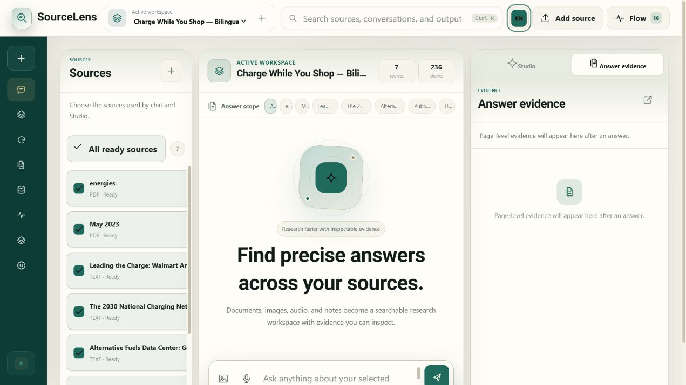
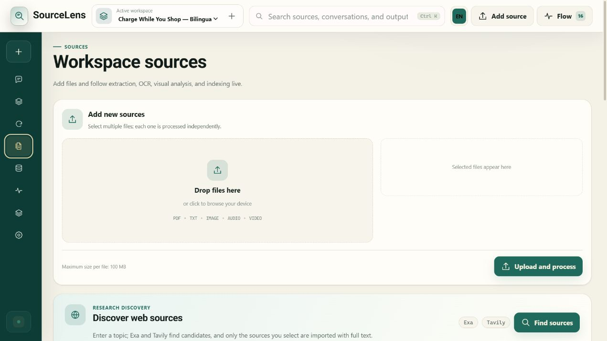
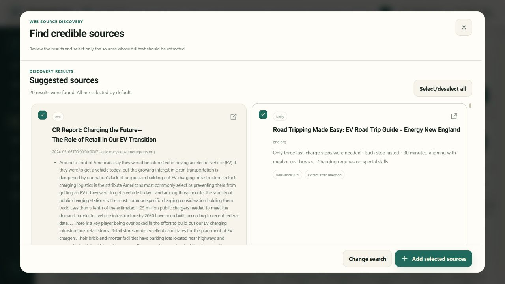
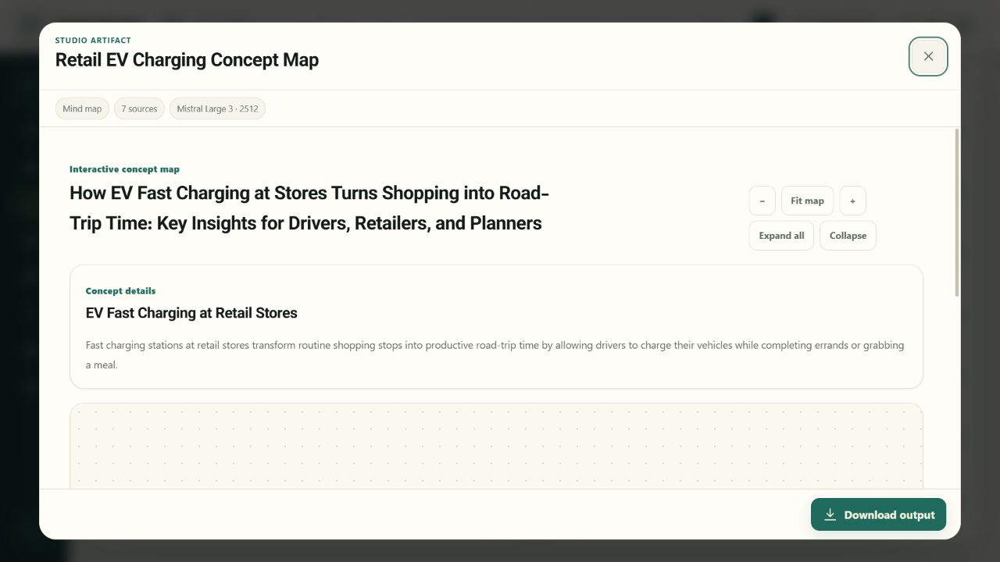
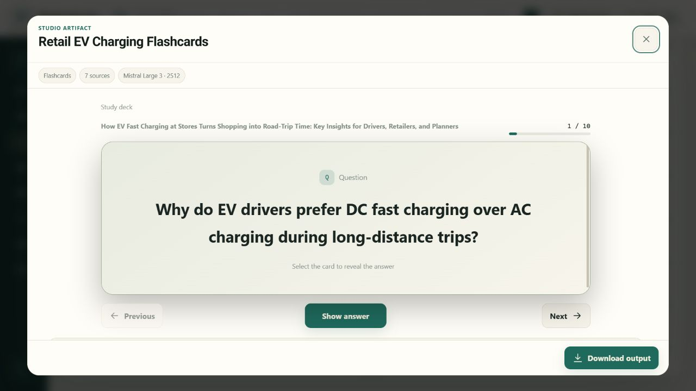
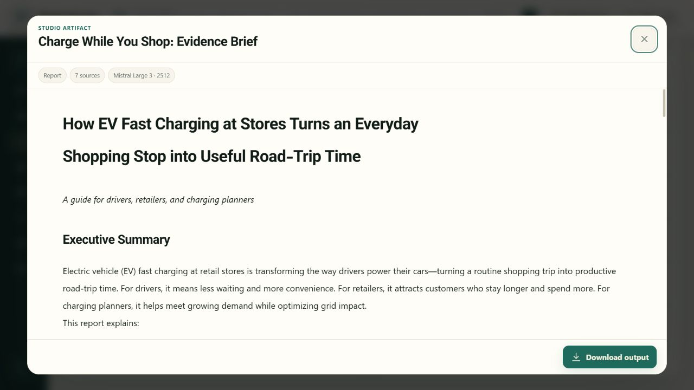
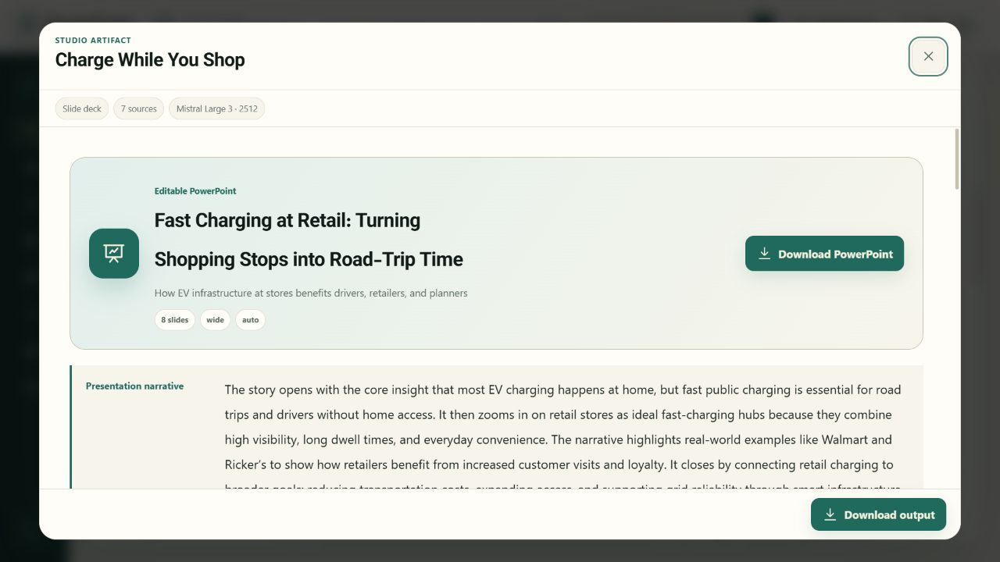
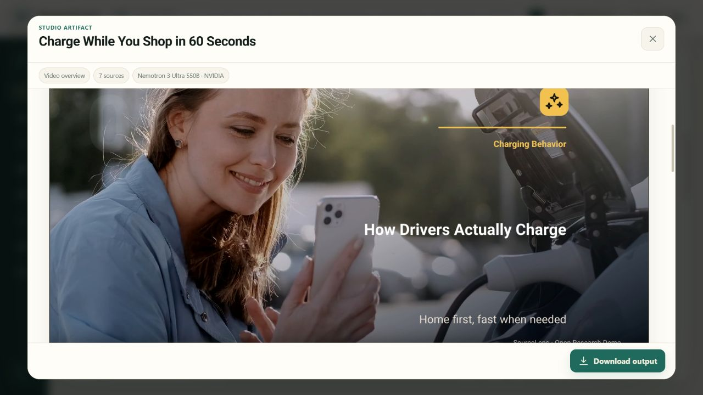
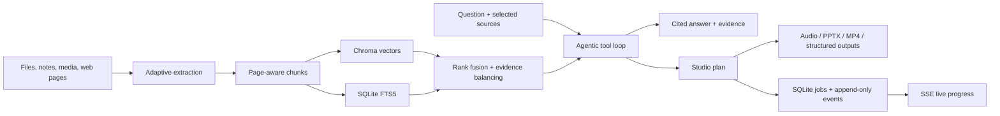

<div align="center">
  
  <h1>SourceLens</h1>
  <p><strong>Multilingual research, grounded in evidence.</strong></p>
  <p>
    Build a cited workspace from documents, media, notes, and the web—then turn that evidence<br>
    into conversations, podcasts, editable slides, videos, reports, study aids, and visual summaries.
  </p>

  [](https://github.com/msmahdinejad/SourceLens/actions/workflows/ci.yml)
  [](https://github.com/msmahdinejad/SourceLens/releases/tag/v2.2.2)
  [](https://www.python.org/)
  [](https://nodejs.org/)
  [](LICENSE)
</div>



SourceLens is a self-hosted research workspace for people who want the convenience of an AI
notebook without losing sight of the evidence. It combines page-aware extraction, selective OCR
and vision, agentic retrieval, inspectable citations, durable job events, and professional local
rendering in one application.

The installable Python package and CLI are named `paperlens` for compatibility.

## Why SourceLens

| Capability | What you get |
| --- | --- |
| Grounded conversation | Source selection, page and segment citations, an evidence drawer, and explicit abstention when the workspace cannot support an answer |
| Agentic RAG | The model can plan multiple searches, choose filters and evidence budgets, and repair invalid tool calls without crashing the request |
| Hybrid retrieval | Chroma vector search and SQLite FTS5 fused for semantic matches, exact terms, identifiers, equations, and Persian text |
| Multimodal ingestion | PDF, text, images, audio, video audio tracks, pasted notes, prompt images, and selected web pages |
| Adaptive extraction | Native text first; OCR and visual analysis only when document signals justify the extra work |
| Research Studio | 13 source-scoped workflows for audio, PowerPoint, video, reports, maps, cards, quizzes, charts, comparisons, and more |
| Live progress | Replayable events, accurate progress, cancellation, retries, cooldowns, and restart recovery |
| Multilingual UX | English LTR and Persian RTL interfaces, retrieval, chat, and Studio outputs |
| Local ownership | Workspaces, sources, indexes, conversations, and generated artifacts stay on the host machine |

## A real bilingual demo

The **Charge While You Shop** walkthrough asks a practical question: can retail car parks become
convenient, reliable, interoperable, and grid-aware EV charging stops? SourceLens processed two
openly licensed studies, added five curated web sources through Search, indexed **236 chunks**, and
generated every Studio format in both English and Persian—**26 application-generated outputs** in
total. The refreshed overview videos run for **50 seconds**, with exact runtimes recorded
in their public manifests.

**[Explore the English demo and downloads](docs/demo/README.md)** ·
**[مشاهدهٔ دمو و خروجی‌های فارسی](docs/demo/README.fa.md)**

Evaluation reports: [English PDF](docs/demo/outputs/SourceLens-demo-evaluation-en.pdf) ·
[English PowerPoint](docs/demo/outputs/SourceLens-demo-evaluation-en.pptx) ·
[Persian PDF](docs/demo/outputs/SourceLens-demo-evaluation-fa.pdf) ·
[Persian PowerPoint](docs/demo/outputs/SourceLens-demo-evaluation-fa.pptx)

### Bring sources into one workspace



Extraction, OCR, visual analysis, transcription, chunking, and indexing publish their progress as
they happen. A source remains usable when optional enrichment is unavailable.

### Search before you import



Web results stay reviewable before import. Selected pages retain their URL and publisher metadata
and enter the same workspace boundary as uploaded files.

### Turn evidence into useful formats







Claims remain tied to the selected sources, while each completed artifact can be inspected and
downloaded from its Studio card.

### Produce editable slides, audio, and video





The visual renderers preserve citations, typography, safe margins, captions, notes, and media
provenance. Video narration stays at its natural speed.

### Work naturally in Persian

The complete interface, retrieval flow, cited chat, evidence panel, and Studio output controls
support Persian RTL as well as English LTR. See the [Persian demo page](docs/demo/README.fa.md) and
[Persian evaluation report](docs/demo/outputs/SourceLens-demo-evaluation-fa.pdf).

## Architecture



SourceLens is a modular monolith built with FastAPI, native ES modules, SQLite WAL/FTS5, Chroma,
bounded workers, Node renderers, and FFmpeg. The local single-node product does not require Redis,
Celery, Postgres, a frontend build chain, or a graph database.

## Quick start

### Requirements

- Python 3.12
- [uv](https://docs.astral.sh/uv/)
- Node.js 20 or newer
- FFmpeg for video composition and optional MP3 export

### Windows

```powershell
git clone https://github.com/msmahdinejad/SourceLens.git
cd SourceLens
uv sync
npm ci --prefix src/paperlens/renderers/deck_engine
npm ci --prefix src/paperlens/renderers/video_engine
Copy-Item .env.example .env
uv run paperlens web
```

### Linux / macOS

```bash
git clone https://github.com/msmahdinejad/SourceLens.git
cd SourceLens
uv sync
npm ci --prefix src/paperlens/renderers/deck_engine
npm ci --prefix src/paperlens/renderers/video_engine
cp .env.example .env
uv run paperlens web
```

Open [http://127.0.0.1:8000](http://127.0.0.1:8000). A new installation starts with one empty
local workspace.

Optional local capabilities:

```powershell
uv sync --extra ocr    # Pillow + Tesseract adapter; install Tesseract separately
uv sync --extra voice  # Faster-Whisper transcription fallback
```

## Providers

Copy `.env.example` to `.env` and configure only the services you want. SourceLens includes routes
for Gemini, Groq, Mistral, NVIDIA NIM, OCR.Space, Exa, Tavily, Pexels, and Jamendo, plus custom
OpenAI-compatible endpoints.

```dotenv
GOOGLE_API_KEYS=google_key_1,google_key_2
GROQ_CHAT_API_KEYS=groq_key_1
MISTRAL_API_KEYS=mistral_key_1
NVIDIA_API_KEYS=nvidia_key_1

EXA_API_KEYS=exa_key_1
TAVILY_API_KEYS=tavily_key_1
PEXELS_API_KEYS=pexels_key_1
JAMENDO_CLIENT_IDS=jamendo_client_id
```

Provider and model priority, capabilities, cooldowns, pacing, OCR/VLM limits, and retrieval settings
can also be managed in the app. See the [provider model catalog](docs/provider-model-catalog.md).

## Retrieval and citations

The research assistant exposes a small set of allowed tools to the model. It can run focused
multi-search plans, choose document/page/section filters, balance evidence across sources, and make
follow-up calls before synthesis. Every final document claim must resolve to selected evidence;
missing context follows an explicit insufficient-evidence path.

The versioned benchmark currently covers 13 pinned CC0 Wikidata revisions, 52 English/Persian
chunks, and 45 questions. FTS5/vector fusion measured **100% Recall@6**, **79.6% citation
precision**, and **100% citation recall**. Alias, multi-hop, and contradiction recall also reached
**100%**, keeping the predefined knowledge-graph gate closed. Results and the graph decision are
documented in the [retrieval benchmark](docs/retrieval-benchmark.md).

## Studio outputs

- **Audio overview** — narrated, scripted, producer-guided, or autonomous; one to five speakers;
  reviewed scripts, turn checkpoints, natural speed, audio, and transcript.
- **Slide deck** — editable PowerPoint, RTL-aware layouts, formulas, charts, verified media,
  citations, speaker notes, and presenter/organization metadata.
- **Video overview** — autonomous scene direction, verified media, natural narration, captions,
  transitions, exact duration, credits, timeline, and diagnostics.
- **Structured research** — reports, concept maps, flashcards, quizzes, infographics, tables,
  charts, timelines, source comparisons, and research-gap analysis.

## Reliability and privacy

- Workspace-local SQLite WAL stores jobs, attempts, leases, revisions, and append-only events.
- SSE replays progress after reconnect; bounded polling is a fallback.
- Cancellation propagates through provider waits, downloads, Node, and FFmpeg processes.
- Startup recovery resumes checkpoint-safe work and marks unsafe work retryable.
- Uploaded names never become storage paths; generated IDs preserve workspace isolation.
- Credentials and workspace content are redacted from status, traces, errors, and release artifacts.

Read [SECURITY.md](SECURITY.md) before exposing the trusted local server to a network. Authentication,
tenant authorization, malware scanning, HTTPS, and a production task queue remain deployment
responsibilities rather than hidden guarantees of the local edition.

## Optional demo corpus

```powershell
uv run paperlens demo
```

The command downloads two CC BY 4.0 electric-mobility studies from their publishers, verifies
pinned SHA-256 checksums, and indexes them through the same ingestion pipeline as user documents.
The PDFs are not stored in Git or distributed in packages. See the
[source and rights note](docs/demo/source-research.md) and
[evidence-backed prompt set](docs/demo_questions.md).

## Development

```powershell
uv sync --extra dev
uv run ruff check .
uv run pytest
uv run pytest --cov=paperlens --cov-report=term-missing
node --check src/paperlens/web/app.js
node --test tests/node/video_engine.test.mjs tests/node/studio_live.test.mjs
npm audit --omit=dev --prefix src/paperlens/renderers/deck_engine
npm audit --omit=dev --prefix src/paperlens/renderers/video_engine
uv run python scripts/license_audit.py
python scripts/repository_policy.py audit
uv build
```

Continuous integration runs the Python and Node suites, dependency and license audits, public-tree
checks, and reproducible package builds. Read [CONTRIBUTING.md](CONTRIBUTING.md) before opening a
pull request.

## Documentation

- [Architecture](docs/architecture.md)
- [Operations, backup, and recovery](docs/operations.md)
- [Provider model catalog](docs/provider-model-catalog.md)
- [Retrieval benchmark](docs/retrieval-benchmark.md)
- [Visual output architecture](docs/visual-output-architecture.md)
- [Charge While You Shop demo](docs/demo/README.md)
- [Demo source and rights note](docs/demo/source-research.md)
- [Security policy](SECURITY.md)
- [Contributing guide](CONTRIBUTING.md)

## License

SourceLens-authored source code and original project assets are licensed under the
[MIT License](LICENSE). Dependencies and bundled assets retain their own licenses.

PDF extraction uses permissively licensed pdfplumber/pdfminer.six; rendering uses pypdfium2 and
PDFium with the required notices. Vazirmatn is distributed under SIL OFL 1.1. See
[THIRD_PARTY_LICENSES.md](THIRD_PARTY_LICENSES.md) for the full dependency and asset notice.
